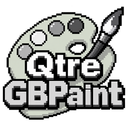
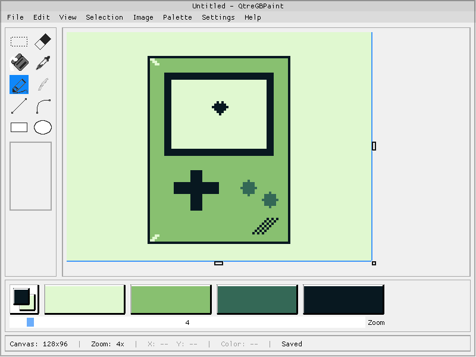
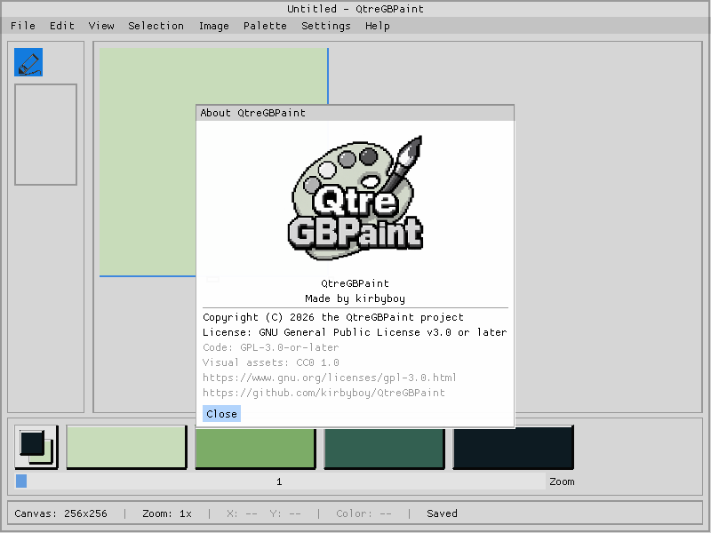

# QtreGBPaint



QtreGBPaint is a small pixel-art paint program in the spirit of classic
MS Paint, with indexed palettes inspired by old retro handheld console.  It
edits images from 1 to 8 bits per pixel and stores them in its own `.idx` format.



## Features

- Single-window Paint-style interface: toolbar, canvas, palette and status bar.
- Indexed images from 1 to 8 bpp (2 to 256 palette entries).
- Palette modes: DMG, Grayscale, Red, Green and Blue, with optional inversion.
- Any visible swatch can be marked as transparent; transparency is shown with a
  checkerboard and is not stored in the document.
- Tools: Selection, Eraser, Fill, Pick Color, Pencil, Brush, Line, Curve, Rect
  and Circle.
- Selection with Normal and Transparent modes, floating region, move, copy, cut,
  paste, delete, invert colors and flip/rotate.
- Fill with contiguous or global mode.
- Brush with 12 footprints; Line and Curve with five stroke widths.
- Curve tool based on a cubic Bézier with editable handles.
- Undo/redo, including canvas resize, bits-per-pixel changes and exact image
  flips/rotations.
- Grid, zoom from 1x to 64x anchored at the pointer, and resize handles.
- Save `.idx` files in `Index`, `Binary`, `Packed` or `BinaryPacked` formats.
- Export copies as 24-bit BMP or indexed PNG.
- Atomic `.idx` saving, recent files and persistent application settings.
- Custom `.ipx` cursors and a native About dialog.

## Screenshots



## Building

Requirements:

- A C++17 compiler (tested with g++)
- SDL2
- zlib
- GNU Make
- Git (only to fetch the local dependencies on the first build)

Local dependencies live in `lib/` and are not versioned. Fetch the pinned
versions once with:

```sh
make deps
```

The bootstrap script clones Dear ImGui v1.92.4 (docking branch),
ImGuiFileDialog v0.6.8 and doctest v2.4.12 into `lib/`, then builds
`libimgui.a` and `libImGuiFileDialog.a`. It is idempotent: if the sources and
libraries are already present, it reuses them. After that, no network access is
needed.

- [Dear ImGui](https://github.com/ocornut/imgui) v1.92.4-docking (the project
  uses `ImGuiConfigFlags_DockingEnable`)
- [ImGuiFileDialog](https://github.com/aiekick/ImGuiFileDialog) v0.6.8 (it also
  vendors the `stb_image` header used to decode PNG files)
- [doctest](https://github.com/doctest/doctest) v2.4.12 for the test suite

Build and run:

```sh
make deps            # first checkout only: fetch and build lib/
make                 # debug: build/QtreGBPaint
make run             # build and run the debug binary
make release         # release: build/QtreGBPaint-release
make run-release     # build and run the release binary
```

Tests:

```sh
make -j"$(nproc)" test       # normal headless suite
make -j"$(nproc)" test-full  # normal + ASAN + UBSAN + ASAN+UBSAN
make -C tests test-circle    # a single test binary
```

The SDL smoke tests live in `temp/` and are not part of the repository:

```sh
./temp/run_smokes.sh                # build and run every smoke test
./temp/run_smokes.sh circle buttons # only the selected smokes
```

The main Makefile also builds `lib/imgui/libimgui.a` and
`lib/ImGuiFileDialog/libImGuiFileDialog.a` if they are missing. If `lib/` has
not been populated yet, run `make deps` first.

## Usage

```sh
./build/QtreGBPaint                 # start with an empty document
./build/QtreGBPaint artwork.idx     # open a file at startup
```

- `File > New` creates a document with a custom width, height and bpp.
- `File > Open` and `File > Save` use ImGuiFileDialog and the `.idx` format.
- `File > Save As...` also lets you choose the `.idx` storage format.
- `File > Export` writes BMP or PNG copies without changing the savepoint.
- `Image > Properties...` resizes the canvas and changes the bits per pixel;
  both operations are undoable.
- `Help > About QtreGBPaint...` shows the logo, author and license.

The palette is deliberately not persisted in this application: a `.idx` file
stores dimensions, bpp and pixel indices only. The application settings (theme,
grid, window geometry, last directory and recent files) are stored in
`$XDG_CONFIG_HOME/qtregbpaint/config.ini` (or
`~/.config/qtregbpaint/config.ini`).

## Design scope

QtreGBPaint intentionally keeps a small scope:

- one window and one document;
- no layers;
- no non-rectangular selections;
- no system-wide image clipboard (copy/paste is internal to the application);
- no stored palette in the document.

These are product decisions, not missing features.

## Project layout

- `src/`, `inc/`: C++17 sources. `core/` contains primitives, `paint/` the
  document, session, renderer and UI, and `tools/` the drawing tools.
- `assets/`: toolbar icons, option sheets, cursors and the application icon.
- `docs/screenshots/`: screenshots used by this README.
- `scripts/`: dependency bootstrap script and its Makefiles.
- `packaging/`: desktop file, icon, MIME XML and AppImage script.
- `tests/`: headless doctest suite.
- `HANDOFF.md`: detailed development log (in Spanish).

## License

- Source code: **GPL-3.0-or-later** (`LICENSE.txt`).
- Visual assets: **CC0 1.0 Universal** public-domain dedication
  (`assets/LICENSE`).
- The QtreGBPaint name and logo are covered by the trademark policy in
  `TRADEMARK.md`.
- Third-party components and notices: `THIRD_PARTY_NOTICES.md`.

## Credits

Made by [kirbyboy](https://github.com/kirbyboy).

Project repository: <https://github.com/kirbyboy/QtreGBPaint>
